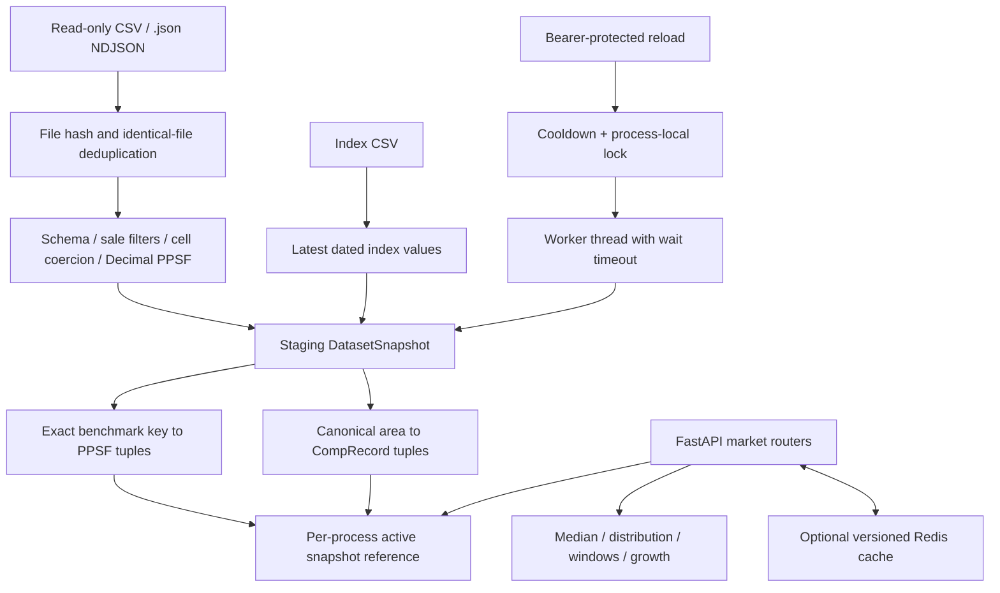

# Data service: low-level design and HTTP contracts

Review date: 2026-11-16. Primary branch `Development`, commit [`7c44244a67657f7ca72b3afd87859984b4650f68`](https://github.com/algoremic/re-data-service/tree/7c44244a67657f7ca72b3afd87859984b4650f68). Default `master` remains at `e9eba341cab3879efe421e80b11c02be7bf4c2ea`: see [default-branch reference](https://github.com/algoremic/re-platform/blob/codex/engineering-review-2026-11-16/docs/engineering-review/services/data-master-reference.md), [findings](https://github.com/algoremic/re-platform/blob/codex/engineering-review-2026-11-16/docs/engineering-review/findings/data-mi.md), [operator manual](../manuals/data-operations-public.md). Branches are not interchangeable: Development adds protected reload, NDJSON, comps, statistics, realized paths and MI's required sales/heatmap APIs. Nothing in this report proves which branch is deployed.

## Responsibilities, modules and storage

Python 3.12+/FastAPI. Owns transaction-file ingestion and market fact/statistic APIs, using read-only local CSV/line-delimited JSON inputs. It has no persistent transaction database or automatic refresh scheduler. Redis is optional response caching. Mongo collection-name helpers/configuration exist for future use, but this ingestion/read path does not persist into Mongo.



| Module | Responsibility |
|---|---|
| `main.py`, `dependencies.py` | Initial load, settings/store/cache lifecycle, request ID, HTTP envelopes |
| `ingest/csv_transactions.py`, `parsers.py` | Three CSV schemas; `.json` means NDJSON, not an array; cell cleanup, unit conversion, sale classification |
| `ingest/runner.py` | File reports, file dedup, hash-derived version, state, area secondary index |
| `store/dataset_store.py` | Snapshot reference, lock, cooldown, worker timeout, replacement |
| `market/lookup.py` | Building exact keys or area-index filtering and relaxation |
| `market/comps.py` | Shared area filtering and paginated comp sort |
| `market/stats.py` | Distribution, YoY, conservative growth heuristics |
| `market/sales_activity.py`, `heatmap_activity.py` | Historical counts and median facts |
| `market/realized_path.py` | Post-sale segment-median horizon windows |
| `security/service_auth.py` | Reload bearer guard, maximum 512-character credential |
| `cache.py` | Cache protocol, null/Redis implementations, fail-soft get/set |

`BenchmarkKey=(emirate,area,building,unit_type,bedrooms)` lowercases strings and defaults emirate to Dubai and bedrooms to zero. Exact key maps retain all accepted PPSF `Decimal`s and latest date. `CompRecord` retains transaction date, price, sqft, PPSF, normalized market attributes and nullable transaction ID. `comp_records_by_area` is a secondary in-memory dictionary to tuples of records; no SQL indexes or database query plans exist. The frozen snapshot has mutable nested dictionaries, so immutability relies on discipline.

Reads capture the active reference; reload builds separately and replaces it once complete. Old readers retain a coherent old snapshot. A degraded staging result is still promoted; timeout/unexpected exception retains the prior reference. Reload lock, cooldown and active version are per process, so multiworker/replica refreshes are not coordinated. Timed-out `to_thread` work can continue after the await releases its lock. `MAX_RELOAD_S` is passed from settings; default 300 seconds, cooldown default 5 seconds.

Dataset version hashes sorted `(path,content hash or MISSING)` entries. It excludes parser/code version, thresholds and area-unit settings. Redis key additionally hashes endpoint query parameters and expires after default 900 seconds. Reusing the same files with changed interpretation can return stale old cached results. File equality dedup does not remove overlapping transaction IDs across different exports. Startup hashes and parses the files in separate reads; source files must be published atomically to avoid mismatched hash/data.

Evidence: [snapshot/index construction](https://github.com/algoremic/re-data-service/blob/7c44244a67657f7ca72b3afd87859984b4650f68/src/re_data/ingest/runner.py#L260), [store](https://github.com/algoremic/re-data-service/blob/7c44244a67657f7ca72b3afd87859984b4650f68/src/re_data/store/dataset_store.py#L25), [authentication](https://github.com/algoremic/re-data-service/blob/7c44244a67657f7ca72b3afd87859984b4650f68/src/re_data/security/service_auth.py#L23).

## Algorithm specification and mathematical meaning

**Ingest.** DLD/recent rows admit sales/sell/transfer and exclude mortgage/gift/inherit terms. Generic comps omit this procedure classification. `PPSF=price_AED/size_sqft`, with `size_sqft=area_sqm×10.7639104167` for DLD unless `DLD_AREA_UNIT=sqft`; reject outside defaults `[100,20000]`. Rows with missing dates can be retained. Recent-export row dates derive from a `YYYY-MM-DD` filename substring. `.json` dispatches to line-delimited DLD-keyed JSON; `.ndjson` does not receive this dispatch. Cleanup strips a leading `=,+,@,-` from string cells before numeric parsing: negative price strings can become positive valid prices (finding DMI-02). Decimal finite checks and invalid-row isolation require strengthening.

**PPSF lookup.** With no building, scan only the canonical area's records, match emirate, try requested unit and bedrooms, then relax bedrooms/unit until any records exist. Unknown bedroom records (`0`) are included in a positive bedroom filter. The returned area `matched_key` always blanks unit and bedrooms even if filters were retained. With a building, use exact-key/empty-key progressive lookup; it does not aggregate all other buildings. Specific building misses may therefore still return no match where an area-only request succeeds. This differs from comps filtering, whose positive-bedroom filter is strict and whose optional relaxation never drops unit type.

**Median/confidence.** Sort PPSFs, symmetrically remove `floor(.1n)` from each tail for `n≥10`, take median. Symmetric trimming leaves the ordinary median unchanged. `c(n)=min(1,ln(n+1)/ln101)` is a count heuristic, not statistical uncertainty or age/quality confidence. The same heuristic is used for area statistics.

**Comps.** Canonical area dictionary lookup; optional emirate/unit/bedroom/building filters. `relax=true` only widens if strict results empty, dropping building then bedrooms. The implementation sorts `(date_is_null,date_string,-float(PPSF))` ascending. This actually returns dated rows **oldest first**, contradicting the function's date-descending docstring. Pagination slices after filtering/sorting; server silently caps `limit` to 100.

**Area statistics.** Distribution summary uses the 10% trimmed sample. Mean is `Σx/n`; quartiles use inclusive `statistics.quantiles` through floating-point conversion and return decimal strings rounded to 10 places. Min/max describe trimmed values, not raw extrema. YoY uses current `[anchor−364,anchor]` and prior `[anchor−729,anchor−365]` (inclusive 365-day windows), anchored to the newest matched record, not today. Gates: ≥50% dated rows, ≥2 distinct dates across all dated records, ≥10 records in each window. Median YoY and lower-quartile YoY are `(current/prior−1)×100`; rounding to two decimals.

**Conservative growth.** G1 is p25 YoY. G2 groups dated observations into calendar years with ≥10 records each, takes the longest consecutive run with year-label span ≥2, calculates p25 CAGR `100[(p_end/p_start)^(1/span_years)−1]`, then takes min(CAGR, worst adjacent-year p25 change). Select the minimum candidate that lies within `[-50%,50%]`; otherwise unavailable. This is a backward-looking heuristic, not a confidence bound or forecast. “3y” is a field name: the longest run need not be limited to three years, need not end recently, and year-label spacing does not guarantee 24 months of actual dated observations. A stale early run can win a tie over a recent run. Out-of-range negative crashes are discarded as noncredible rather than retained as worst case, which needs explicit product policy.

**Sales activity.** Area max transaction date anchors an inclusive `lookback_days` window; if matching rows have no dates, fallback anchor is dataset max, but undated records are excluded from counts. Unknown area returns no window. Count by unit label, sorted descending count/ascending label; `below_minimum_n = n<10`. No percentages: MI owns pie math.

**Heatmap activity.** Dataset-wide max date anchors one common inclusive 180/365/730-day window, enabling area comparison. One pass through area records, optional emirate filter, count and untrimmed median per area; no demand classification. Area-to-emirate static mappings default unknown locations to Dubai, which limits other-emirate correctness.

**Realized path.** For h∈{6,12,24}, add calendar months to sale date with end-of-month clipping. If the newest matching transaction is earlier than horizon end, mark immature. Else median all matching dated PPSFs in `(sale_date,sale_date+h]`; fewer than 10 means below-minimum. Horizons are cumulative historical windows, not point-in-time resale estimates or forecasts.

**Published index.** Latest dated CSV row wins per segment/horizon. Numeric index columns may all be null and still produce a loaded/`ok:true` snapshot; freshness and numeric completeness are not readiness criteria.

Evidence: [PPSF relaxation](https://github.com/algoremic/re-data-service/blob/7c44244a67657f7ca72b3afd87859984b4650f68/src/re_data/market/lookup.py#L61), [comp filtering/sort](https://github.com/algoremic/re-data-service/blob/7c44244a67657f7ca72b3afd87859984b4650f68/src/re_data/market/comps.py#L26), [growth equations](https://github.com/algoremic/re-data-service/blob/7c44244a67657f7ca72b3afd87859984b4650f68/src/re_data/market/stats.py#L87), [sales window](https://github.com/algoremic/re-data-service/blob/7c44244a67657f7ca72b3afd87859984b4650f68/src/re_data/market/sales_activity.py#L49), [realized windows](https://github.com/algoremic/re-data-service/blob/7c44244a67657f7ca72b3afd87859984b4650f68/src/re_data/market/realized_path.py#L58).

## HTTP contract inventory

No JSON request bodies. Market reads/metadata/root/health are unauthenticated; keep internal unless intentionally public. Admin reload requires `Authorization: Bearer <DATA_SERVICE_TOKEN>` in every environment and fails closed if unset. Sanitized `X-Request-ID` is echoed/generated. All monetary/size/statistical Decimal fields serialize as strings or null. Generated `/docs`, `/redoc`, `/openapi.json`, `/docs/oauth2-redirect` are enabled.

| Method/path | Query/path inputs | Success and empty behavior |
|---|---|---|
| `GET /` | none | 200 message/version/docs/health/env |
| `GET /health` | none | 200 complete; 503 degraded; `ok,service,env,data_state,dataset_version,ingested_at` |
| `GET /v1/dataset` | none | metadata 200; no snapshot 503 |
| `POST /v1/admin/reload` | bearer; no body | metadata 200 even if staging degraded; 401/403/409/429/503 errors below |
| `GET /v1/market/areas` | optional string emirate | all matching dropdown items 200; no pagination |
| `GET /v1/market/ppsf` | optional emirate/area/building/unit_type strings, integer bedrooms (0 unspecified) | 200 found/value/sample/confidence/matched key or found=false |
| `GET /v1/market/index/latest` | segment all(default)/flat/villa; horizon yearly(default)/monthly/quarterly | 200 ok and index or ok=false |
| `GET /v1/market/comps` | required area; optional emirate/unit_type/building; bedrooms int≥0 default0; relax bool false; skip int≥0 default0; limit int≥1 default20 capped100 | 200 total/items/matched_scope/source/version/state |
| `GET /v1/market/stats/{area}` | area path; optional emirate/unit_type; bedrooms≥0 default0, relax=false | 200 distribution/growth summary; ok=false and null stats if no rows |
| `GET /v1/market/realized-path` | required area, sale_date ISO date string; optional emirate/unit_type; bedrooms≥0 default0, relax=false | 200 cumulative 6/12/24-month outcomes |
| `GET /v1/market/sales-activity` | required area≤256 chars, lookback_days∈{180,365,730}; optional emirate≤64 chars | 200 count, window, slices and provenance |
| `GET /v1/market/heatmap-activity` | required lookback_days∈{180,365,730}; emirate≤64 default Dubai | 200 per-area facts; note response omits dataset_version |

**Common payloads.** Metadata: `{version,ingested_at,state,files,totals,duplicate_content_hashes}`. Each file report has `{path,name,status,schema,content_hash,size_bytes,rows_read,rows_accepted,rows_skipped,skip_reasons:{filtered_procedure,out_of_bounds_ppsf,unparseable},duplicate_content_hash_of}`; nullable hash/schema/size/duplicate fields. Status `loaded|partial|missing|failed`. Totals `{accepted_transaction_rows,index_loaded,index_snapshot_count,latest_transaction_date}`; internal comp count is not exposed by this metadata model. Duplicate group `{content_hash,paths}`.

PPSF `{found,aed_per_sqft,sample_size,confidence,last_updated,source,matched_key,dataset_version,data_state}`. Matched key has five benchmark dimensions. Index `{ok,date,segment,horizon,index_value,price_index_value,message,dataset_version,data_state}`. Areas `{items:[{value,label,emirate}],dataset_version,data_state}`.

Comp `{transaction_date,price_aed,size_sqft,aed_per_sqft,emirate,area,building,unit_type,bedrooms,transaction_id}`; date/id nullable. Matched scope `{emirate,area,unit_type,bedrooms,building,relaxed}`. Stats includes all fields illustrated below; nullable values are emitted. Realized horizon `{horizon_months:6|12|24,status:ok|immature|below_minimum_n,median_ppsf:decimal-string|null,sample_size:int|null}`.

## Request/response examples

Illustrative fixture values, not production measurements. `fixture-version` stands for a generated SHA-256 dataset version. Full machine-generated OpenAPI is in `../contracts/data-openapi.json` when packaged; code models remain authoritative.

```http
GET /v1/market/comps?area=jvc&unit_type=flat&bedrooms=1&skip=0&limit=20
```
```json
{"total":1,"items":[{"transaction_date":"2026-01-25","price_aed":"1000000","size_sqft":"500","aed_per_sqft":"2000","emirate":"dubai","area":"jumeirah village circle","building":"tower a","unit_type":"flat","bedrooms":1,"transaction_id":"fixture-1"}],"matched_scope":{"emirate":null,"area":"jumeirah village circle","unit_type":"flat","bedrooms":1,"building":"","relaxed":false},"source":"DLD public transaction data","dataset_version":"fixture-version","data_state":"complete"}
```
```http
GET /v1/market/stats/jvc?unit_type=flat&bedrooms=1
```
```json
{"ok":true,"area":"jumeirah village circle","emirate":"dubai","matched_scope":{"emirate":null,"area":"jumeirah village circle","unit_type":"flat","bedrooms":1,"building":"","relaxed":false},"transaction_count":1,"median_ppsf":"2000","mean_ppsf":"2000","p25_ppsf":"2000","p75_ppsf":"2000","min_ppsf":"2000","max_ppsf":"2000","confidence":0.15019048322368794,"date_range":{"from":"2026-01-25","to":"2026-01-25"},"yoy_available":false,"yoy_median_ppsf_change_pct":null,"message":null,"source":"DLD public transaction data","dataset_version":"fixture-version","data_state":"complete","yoy_p25_ppsf_change_pct":null,"cagr_3y_lower_annual_pct":null,"conservative_growth_annual_pct":null,"growth_suggestion_available":false,"growth_method":null}
```
```http
GET /v1/market/sales-activity?area=jvc&lookback_days=180&emirate=Dubai
```
```json
{"transaction_count":1,"date_range":{"from":"2025-07-30","to":"2026-01-25"},"window_end_source":"area_max","slices":[{"label":"flat","count":1}],"below_minimum_n":true,"dataset_version":"fixture-version","data_state":"complete","source":"DLD public transaction data","matched_scope":{"emirate":"dubai","area":"jumeirah village circle"}}
```
```http
GET /v1/market/heatmap-activity?lookback_days=180
```
```json
{"date_range":{"from":"2025-07-30","to":"2026-01-25"},"items":[{"area":"jvc","label":"Jumeirah Village Circle","transaction_count":1,"median_ppsf":"2000"}],"data_state":"complete","source":"DLD public transaction data"}
```
```http
GET /v1/market/realized-path?area=jvc&sale_date=2026-01-25
```
```json
{"area":"jumeirah village circle","sale_date":"2026-01-25","anchor_date":"2026-01-25","horizons":[{"horizon_months":6,"status":"immature","median_ppsf":null,"sample_size":null},{"horizon_months":12,"status":"immature","median_ppsf":null,"sample_size":null},{"horizon_months":24,"status":"immature","median_ppsf":null,"sample_size":null}],"disclaimer":"Outcomes are area/segment median PPSF after the sale date, not this unit's resale price.","matched_scope":{"emirate":null,"area":"jumeirah village circle","unit_type":null,"bedrooms":0,"building":"","relaxed":false},"dataset_version":"fixture-version","data_state":"complete"}
```
```http
GET /v1/market/ppsf?area=jvc&unit_type=flat&bedrooms=1
```
```json
{"found":true,"aed_per_sqft":"2000","sample_size":1,"confidence":0.15019048322368794,"last_updated":"2026-01-25","source":"csv","matched_key":{"emirate":"dubai","area":"jumeirah village circle","building":"","unit_type":"","bedrooms":0},"dataset_version":"fixture-version","data_state":"complete"}
```
`GET /v1/market/areas` → `{"items":[{"value":"jvc","label":"Jumeirah Village Circle","emirate":"dubai"}],"dataset_version":"fixture-version","data_state":"complete"}`.

`GET /v1/market/index/latest?segment=all&horizon=yearly` → `{"ok":true,"date":"2026-02-01","segment":"all","horizon":"yearly","index_value":"1.3","price_index_value":"1.3","message":null,"dataset_version":"fixture-version","data_state":"complete"}`.

`GET /` → `{"message":"Dubai/UAE Real Estate Data Service","version":"0.1.0","docs":"/docs","health":"/health","env":"local"}`.

`GET /health` with no complete dataset → 503 `{"ok":false,"service":"re-data-service","env":"local","data_state":"degraded","dataset_version":null,"ingested_at":"2026-11-16T12:00:00.000Z"}`. This is readiness-like; a degraded service can still return useful market reads.

`GET /v1/dataset` or authenticated `POST /v1/admin/reload` → metadata, e.g. `{"version":"fixture-version","ingested_at":"2026-11-16T12:00:00.000Z","state":"degraded","files":[],"totals":{"accepted_transaction_rows":0,"index_loaded":false,"index_snapshot_count":0,"latest_transaction_date":null},"duplicate_content_hashes":[]}` when no files configured.

No-match PPSF returns 200 with `found:false`, money/confidence/date/source/key null and sample size 0. No-match comps returns total 0/items[]. Sales can be 200 with zero count, no dates, slices[] and below_minimum_n=true. HTTP success never substitutes for checking payload state.

## Error contracts

All normal validation/auth/reload errors use `{error:string,details:string[]}`. Examples:

| Trigger | HTTP | Payload |
|---|---|---|
| No DATA_SERVICE_TOKEN configured | 503 | `{"error":"Admin reload auth not configured","details":["Set DATA_SERVICE_TOKEN in the service environment"]}` |
| Missing bearer | 401 | `{"error":"Missing bearer token","details":["Authorization: Bearer <token> required"]}` |
| Wrong scheme | 401 | `{"error":"Invalid authorization scheme","details":["Use Authorization: Bearer <token>"]}` |
| Wrong/oversize credential | 403 | `{"error":"Invalid service token","details":["Bearer token rejected"]}` |
| Another process-local reload active (after cooldown check) | 409 | `{"error":"Reload already in progress","details":["retry after the current ingest completes"]}` |
| Within cooldown, including first seconds of active reload | 429 | `{"error":"Reload cooldown active","details":["retry after the cooldown window expires"]}` |
| Worker await exceeds MAX_RELOAD_S | 503 | `{"error":"Dataset reload timed out","details":["Ingest exceeded MAX_RELOAD_S; prior snapshot unchanged"]}` |
| Unsupported lookback_days | 422 | `{"error":"Please check the highlighted inputs.","details":["lookback_days: Input should be 180, 365, or 730"]}` |
| Invalid bedrooms integer | 422 | input-validation envelope with `query.bedrooms: ...`; Pydantic wording can vary |
| No active snapshot on dataset route | 503 | `{"error":"Dataset not loaded","details":["Dataset not loaded"]}` |
| Unknown path | 404 | `{"error":"Not found","details":["The requested resource does not exist"]}` |

Evidence: [all market routes](https://github.com/algoremic/re-data-service/blob/7c44244a67657f7ca72b3afd87859984b4650f68/src/re_data/routers/market.py#L211), [response models](https://github.com/algoremic/re-data-service/blob/7c44244a67657f7ca72b3afd87859984b4650f68/src/re_data/models/market_api.py#L50), [admin statuses](https://github.com/algoremic/re-data-service/blob/7c44244a67657f7ca72b3afd87859984b4650f68/src/re_data/routers/admin.py#L23).

## Change guidance and acceptance gates

Add/modify an ingest schema in `csv_transactions.py` with CSV and NDJSON parity fixtures and explicit units/date semantics; preserve raw data meaning and reject invalid signs/nonfinite values. Evolve additive response models plus OpenAPI/consumer contract tests before deployment. Change formulas in `stats.py` only with product-approved meaning, independent worked examples, temporal and segment-bias checks. Benchmark distribution changes rather than equating test coverage with statistical validity. Add transaction-level dedup and data freshness gates before trusting larger merged exports. Change cache versioning whenever interpretation changes. Protect atomic source publication and versioned rollback. Coordinate reloads and active versions across replicas before increasing worker counts. See findings and manual for proposed priorities; these improvements were not applied by this documentation review.
